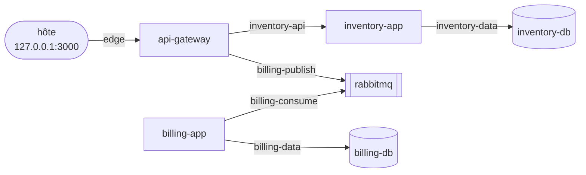
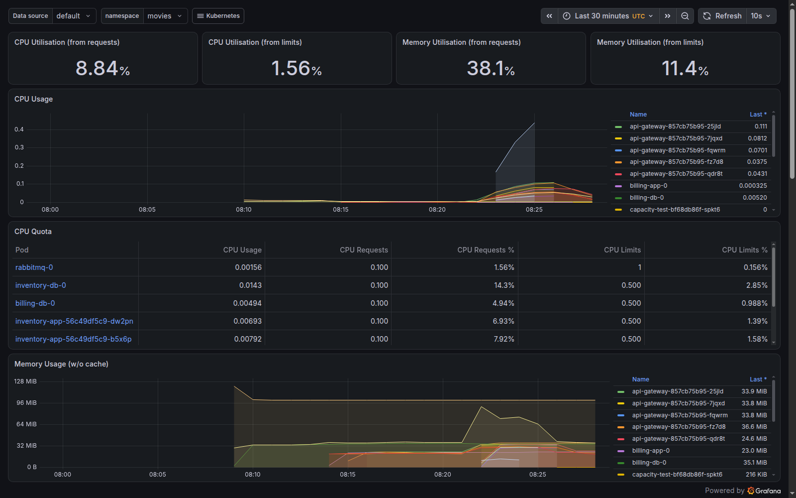

# Infrastructure — Construction d'une infrastructure moderne, du réseau à la supervision

**Auteur :** `clecart` — **Filière :** Master · Green IT — **Pile (héritée de code-keeper, à compléter) :** Docker 29.10.0 · Docker Compose 5.7.1 · GitLab CE 19.5.1 · GitLab Runner 19.5.0 ·
Ansible 2.21.5 · Terraform 1.16.6 (fournisseur AWS 6.69.1, modules VPC 6.7.3 et EKS 21.29.0) ·
Amazon EKS 1.36 · Helm · kube-prometheus-stack · Trivy 0.76.1 · TFLint 0.64.0 · Renovate 44.176.2 · Node.js 24

Ce document est à la fois le **compte-rendu** du projet et sa **documentation
complète**. Il reprend d'abord le sujet officiel, puis suit l'avancement des
livrables de chaque sous-phase. La préparation de l'évaluation et de la
soutenance est dans [REVISION-AUDIT.md](REVISION-AUDIT.md).

> **Source du sujet** — Gitea Zone01 Normandie :
> [`vfrebourg/public` · `subjects/green-it/infrastructure/README.md`](https://zone01normandie.org/git/vfrebourg/public/src/branch/main/subjects/green-it/infrastructure/README.md)
> (branche `main`). Page du projet sur l'intra :
> <https://zone01normandie.org/intra/rouen/master/infrastructure?event=1311>.

---

## Sommaire

1. [Sujet](#1-sujet)
2. [Suivi des livrables](#2-suivi-des-livrables)
3. [Origine du code](#3-origine-du-code)
4. [Application conteneurisée : Docker Compose](#4-application-conteneurisée--docker-compose)
5. [Architecture réseau](#5-architecture-réseau)
6. [Une séance sur AWS, de la création à la destruction](#6-une-séance-sur-aws-de-la-création-à-la-destruction)
7. [Orchestration sur Kubernetes (EKS)](#7-orchestration-sur-kubernetes-eks)
8. [Coûts de l'infrastructure](#8-coûts-de-linfrastructure)
9. [CI/CD et infrastructure par Terraform](#9-cicd-et-infrastructure-par-terraform)
10. [Supervision](#10-supervision)
11. [Rapport d'audit de sécurité](#11-rapport-daudit-de-sécurité)
12. [Vérifier avant de pousser : la porte locale](#12-vérifier-avant-de-pousser--la-porte-locale)

---

## 1. Sujet

Bienvenue dans un parcours complet de construction d’une infrastructure moderne, de zéro jusqu’à un niveau professionnel.

#### Objectifs

L'objectif de ce projet est de maîtriser les outils et pratiques permettant de construire, déployer, automatiser et superviser une application dans un environnement professionnel.

#### Introduction

- Votre travail doit être structuré et documenté en français clair et technique.
- Chaque choix d’architecture doit être justifié.
- L’infrastructure doit être pensée comme un système complet, évolutif et reproductible.

Vous allez progressivement construire une infrastructure complète en parcourant toutes les couches d’un système moderne : réseau, conteneurisation, orchestration, automatisation et supervision.

Ce projet est découpé en plusieurs sous-phases.

---

#### Sous-phase 1 — Réseau & conteneurs

Vous commencez par comprendre la circulation de l’information dans un système d’information, puis vous mettez en place vos premiers environnements conteneurisés avec Docker.

L’objectif est de produire des images légères, reproductibles et prêtes à être déployées.

##### Livrable

- 1 application conteneurisée fonctionnelle
- 1 documentation d’architecture réseau

---

#### Sous-phase 2 — Orchestration & cloud

Vous déployez votre application à l’échelle avec Kubernetes sur une infrastructure AWS.

Vous apprenez à gérer les ressources, les namespaces, le scaling, et à analyser les coûts et impacts des choix d’infrastructure.

##### Livrable

- 1 application orchestrée sur cluster Kubernetes
- 1 déploiement sur AWS
- 1 analyse des coûts d’infrastructure

---

#### Sous-phase 3 — CI/CD & IaC

Vous automatisez l’ensemble du cycle de vie de l’application : tests, déploiement continu avec GitHub Actions ou GitLab CI, et provisionnement via Terraform.

L’infrastructure devient du code, versionnable, reproductible et détruisable proprement.

##### Livrable

- 1 pipeline CI/CD complet fonctionnel
- 1 infrastructure provisionnée via Terraform

---

#### Sous-phase 4 — Supervision & sécurité

Vous mettez en place la supervision de l’infrastructure avec Prometheus et Grafana.

Vous intégrez des pratiques DevSecOps : gestion des secrets, principe du moindre privilège, audit de vulnérabilités.

##### Livrable

- 1 tableau de bord de supervision opérationnel
- 1 rapport d’audit de sécurité

---

#### Validation finale

Une soutenance technique devant jury professionnel présentant un projet fil rouge intégrant l’ensemble des sous-phases.

---

#### Ce projet vous permettra de découvrir :

- La construction d’une infrastructure complète moderne.
- La conteneurisation et l’orchestration d’applications.
- Le déploiement cloud avec AWS et Kubernetes.
- L’automatisation CI/CD et l’infrastructure as code.
- La supervision et la sécurité en environnement DevSecOps.

---

## 2. Suivi des livrables

| Sous-phase | Livrable | État | Preuve |
|---|---|---|---|
| 1 — Réseau & conteneurs | Application conteneurisée fonctionnelle | ☑ | [section 4](#4-application-conteneurisée--docker-compose), `Scripts/compose-test.sh` |
| 1 — Réseau & conteneurs | Documentation d'architecture réseau | ☑ | [section 5](#5-architecture-réseau) : local et staging mesurés le 17 novembre (`Scripts/compose-test.sh`, captures AWS et Kubernetes) |
| 2 — Orchestration & cloud | Application orchestrée sur cluster Kubernetes | ☑ | [section 7](#7-orchestration-sur-kubernetes-eks) : 8 pods, HPA et autoscaler éprouvés (`Scripts/load-test.sh pods` et `nodes`) |
| 2 — Orchestration & cloud | Déploiement sur AWS | ☑ | [section 6](#6-une-séance-sur-aws-de-la-création-à-la-destruction) : staging construit le 17 novembre ; `Scripts/test-api.sh staging` 16/16 par l'URL publique |
| 2 — Orchestration & cloud | Analyse des coûts d'infrastructure | ◐ | [section 8](#8-coûts-de-linfrastructure) : tarifs relevés dans l'API de prix d'AWS ; facture réelle de la séance à lire dans Cost Explorer |
| 3 — CI/CD & IaC | Pipeline CI/CD complet fonctionnel | ☑ | [section 9](#9-cicd-et-infrastructure-par-terraform) : pipelines `infra` n° 1 et applications n° 3, 4, 5 ; `Scripts/protection-test.sh` 9/9 |
| 3 — CI/CD & IaC | Infrastructure provisionnée via Terraform | ☑ | [sections 6 et 9](#6-une-séance-sur-aws-de-la-création-à-la-destruction) : socle 54 ressources, staging 88, plans relus avant l'apply, destruction complète |
| 4 — Supervision & sécurité | Tableau de bord de supervision opérationnel | ☑ | [section 10](#10-supervision) : Grafana capturé pendant la montée en charge ; journaux dans CloudWatch |
| 4 — Supervision & sécurité | Rapport d'audit de sécurité | ☑ | [section 11](#11-rapport-daudit-de-sécurité) : secrets, moindre privilège (`rbac-test.sh` 118/118), vulnérabilités (ECR, Trivy, SAST) |
| Validation finale | Soutenance technique devant jury (projet fil rouge) | ☐ | préparation : [REVISION-AUDIT.md](REVISION-AUDIT.md) |

---

## 3. Origine du code

Le socle du projet est importé tel quel du projet **code-keeper**
(`clecart/code-keeper`, commit `66ef390`, 22 octobre 2026), qui réunit déjà
l'application en microservices, l'infrastructure Terraform sur AWS (EKS), la
configuration Ansible de GitLab, les pipelines GitLab CI, les manifests Helm
(dont `kube-prometheus-stack`) et l'analyse de vulnérabilités Trivy.

- Seuls les fichiers suivis par git ont été importés (`git archive`) : aucun
  état Terraform, aucune variable locale, aucun secret Ansible ni preuve de test.
- Le compte-rendu et la fiche de révision d'origine sont conservés dans
  [docs/import/code-keeper/](docs/import/code-keeper/).
- Les ressources (AWS, Kubernetes, groupe GitLab) portent le nom de
  l'application qu'elles servent, un catalogue de films avec prise de
  commandes : **`movies`** (`movies-staging`, `movies/billing-app`,
  `movies-ci-infra`…). Le nom tient sous la limite de 32 caractères d'AWS pour
  le groupe cible de l'ALB (`movies-staging-api-gateway`, 26).

Les mêmes services figurent dans les projets antérieurs, qui restent des
références pour certaines sous-phases :

| Projet | Apport | Sous-phase |
|---|---|---|
| play-with-containers | Application sous Docker Compose | 1 |
| deep-in-net | Exercices réseau | 1 |
| orchestrator | Kubernetes (K3s) sous Vagrant | 2 |
| cloud-design | EKS, Terraform, coûts, supervision | 2, 4 |
| code-keeper | CI/CD, IaC, sécurité — **socle importé** | 2, 3, 4 |

---

## 4. Application conteneurisée : Docker Compose

`compose.yaml` lance l'application entière sur le poste, à partir des recettes
du dépôt : les images qui tournent en local sont celles que la CI construit et
qu'EKS déploie.

```bash
cp .env.example .env                  # puis remplacer chaque CHANGE_ME (openssl rand -hex 24)
docker compose up -d --build --wait   # construit, démarre, attend que tout soit sain
Scripts/compose-test.sh               # 92 vérifications, sortie en échec si une tombe
curl http://127.0.0.1:3000/api/movies/
docker compose down                   # ajouter -v pour effacer aussi les données
```

| Service | Recette | Rôle | Port | Mémoire mesurée au repos / limite | Image |
|---|---|---|---|---|---|
| `api-gateway` | `repos/api-gateway-app` | point d'entrée : `/api/movies` vers inventory-app, `/api/billing` vers RabbitMQ | 3000, publié sur `127.0.0.1` | 23 Mio / 256 Mio | 121 Mo |
| `inventory-app` | `repos/inventory-app` | API REST du catalogue de films | 8080 | 22 Mio / 256 Mio | 115 Mo |
| `billing-app` | `repos/billing-app` | consomme les commandes de la file `billing_queue` | 8080 | 22 Mio / 256 Mio | 116 Mo |
| `inventory-db` | `repos/infra/images/inventory-database` | PostgreSQL 17, table `movies` | 5432 | 22 Mio / 384 Mio | 73 Mo |
| `billing-db` | `repos/infra/images/billing-database` | PostgreSQL 17, table `orders` | 5432 | 25 Mio / 384 Mio | 73 Mo |
| `rabbitmq` | `repos/infra/images/rabbitmq-server` | courtier AMQP, file durable `billing_queue` | 5672 | 92 Mio / 512 Mio | 204 Mo |

Mesures du 17 novembre 2026 sur le poste de développement (`docker stats`,
`docker image ls`), journaux dans le dossier local `preuves/` (ignoré par Git) :
205 Mio de mémoire pour toute la pile au repos ; construction sans cache en 9 s,
l'image de base Alpine déjà présente ; démarrage jusqu'à l'état sain des six
services en 17 s.

**Choix et leur motif**

- **Les noms de service sont ceux de Kubernetes** (`inventory-db`, `billing-db`,
  `rabbitmq`) : les applications reçoivent les mêmes variables d'environnement
  en local et dans le cluster.
- **Le durcissement reprend celui des manifestes** : système de fichiers
  racine en lecture seule, toutes les capacités Linux retirées,
  `no-new-privileges`, utilisateur non-root fixé par la recette, `requests` et
  `limits` recopiés en réservations et limites. Les répertoires où un service
  doit écrire sont des volumes nommés (données) ou des `tmpfs` (socket,
  configuration générée au démarrage).
- **Les secrets viennent de `.env`**, que Git ignore ; Compose refuse de
  démarrer si l'un manque (`${VAR:?}`).
- **RabbitMQ reçoit la taille de sa mémoire par l'environnement**
  (`RABBITMQ_SERVER_ADDITIONAL_ERL_ARGS`) : il calcule sinon son seuil d'alarme
  sur la mémoire de l'hôte, et serait tué par sa limite de 512 Mio avant de
  freiner les producteurs. Mesuré : seuil de 0,322 Go, soit 0,6 × 512 Mio.
  Le fichier de configuration du cluster (ConfigMap) n'est pas repris :
  Compose refuse une configuration écrite en ligne dans un service en lecture
  seule.
- **Alternative écartée** : les images officielles `postgres` et `rabbitmq`.
  Le job `integration-test` les emploie comme services GitLab ; la pile locale
  prend les images que le cluster déploie, pour éprouver ce qui part en
  production.

**Preuve** : `Scripts/compose-test.sh`, sur la pile lancée. Il vérifie
l'entrée (publiée sur la seule boucle locale), le catalogue (création puis
recherche d'un film), la facturation (la commande arrive dans `billing-db`),
la file d'attente (`billing-app` arrêté, la commande attend dans RabbitMQ puis
s'enregistre à son retour), l'isolement réseau sur les 30 couples de services
(section 5) et le durcissement de chaque conteneur. Le test a été éprouvé à
l'envers : `billing-app` ajouté au réseau de publication fait tomber deux
vérifications, `read_only: false` sur une base en fait tomber une.

---

## 5. Architecture réseau

### 5.1 Circulation d'une requête

| Flux | De | Vers | Protocole, port |
|---|---|---|---|
| Lecture et écriture du catalogue | client | `api-gateway` | HTTP 3000 |
| | `api-gateway` (mandataire) | `inventory-app` | HTTP 8080 |
| | `inventory-app` | `inventory-db` | PostgreSQL 5432 |
| Commande | client | `api-gateway` | HTTP 3000 |
| | `api-gateway` (publie) | `rabbitmq`, file `billing_queue` | AMQP 0-9-1, 5672 |
| | `billing-app` (consomme) | `rabbitmq` | AMQP 0-9-1, 5672 |
| | `billing-app` | `billing-db` | PostgreSQL 5432 |

La commande est asynchrone : `api-gateway` répond dès que RabbitMQ a reçu le
message, et la commande attend dans la file durable tant que `billing-app` est
arrêté.

### 5.2 En local : un réseau par flux



| Réseau | Interne | Membres | Flux porté |
|---|---|---|---|
| `edge` | non | `api-gateway` | entrée depuis l'hôte, sortie vers Internet |
| `inventory-api` | oui | `api-gateway`, `inventory-app` | mandataire HTTP |
| `inventory-data` | oui | `inventory-app`, `inventory-db` | SQL du catalogue |
| `billing-publish` | oui | `api-gateway`, `rabbitmq` | publication des commandes |
| `billing-consume` | oui | `billing-app`, `rabbitmq` | consommation des commandes |
| `billing-data` | oui | `billing-app`, `billing-db` | SQL des commandes |

- **Deux services ne se joignent que s'ils partagent un réseau.** Docker isole
  les ponts entre eux, et son DNS ne résout un nom que sur les réseaux du
  demandeur. RabbitMQ porte deux réseaux pour que `api-gateway` et
  `billing-app` ne se voient pas.
- **Un réseau interne n'a pas de route hors de l'hôte** : seul `api-gateway`
  en a une, par `edge`. Une base compromise n'a aucune route vers Internet.
- **Seule l'entrée est publiée**, et sur la boucle locale de l'hôte : la pile
  n'est pas joignable depuis le réseau du poste.
- **Les adresses ne se fixent pas** : Docker attribue un sous-réseau à chaque
  réseau dans sa réserve (`172.20.0.0/16` à `172.26.0.0/16` sur le poste), et
  les services se trouvent par leur nom.

**Mesuré** par `Scripts/compose-test.sh` : pour chacun des 30 couples
ordonnés de services, une connexion TCP est tentée vers chaque adresse de la
cible, et pas seulement par son nom ; elle n'aboutit que pour les cinq paires
du schéma, et seulement sur l'adresse de leur réseau commun. L'absence de route
par défaut se lit dans `/proc/net/route` de chaque conteneur.

**Limite assumée** : un réseau Compose laisse passer les deux sens et tous les
ports, là où une NetworkPolicy filtre par sens et par port. En local,
`inventory-app` peut donc ouvrir une connexion vers `api-gateway:3000`,
`inventory-db` vers `inventory-app:8080`, `billing-db` vers `billing-app:8080`
et `rabbitmq` vers `api-gateway:3000` ; le cluster refuse ces quatre sens.

### 5.3 Sur AWS

Cette partie décrit ce que construit le code Terraform et Kubernetes du dépôt,
et chaque point a été vérifié le 17 novembre 2026 sur staging, construit par le
pipeline `infra` n° 1 (`aws ec2`, `elbv2`, `apigatewayv2`, `eks`, `kubectl` ;
journaux dans le dossier local `preuves/`). La prod n'est pas déployée : elle
appelle le même module, avec la plage `10.1.0.0/16`.

Extrait de la capture (identifiants abrégés) :

```text
VPC        movies-staging 10.0.0.0/16      movies-tooling 10.100.0.0/24
Subnets    private 10.0.0.0/19 (3a), 10.0.32.0/19 (3b)   public 10.0.96.0/24 (3a), 10.0.97.0/24 (3b)
Routes     staging-private 0.0.0.0/0 -> nat-…     staging-public 0.0.0.0/0 -> igw-…
           tooling-public  0.0.0.0/0 -> igw-…     one NAT gateway, available
SG alb     in  tcp 80    from sg vpc-link  "HTTP from the API Gateway VPC link only"
           out tcp 30080 to   sg nodes     "api-gateway NodePort on the worker nodes"
SG vpclink out tcp 80    to   sg alb       "HTTP to the internal ALB"
ALB        movies-staging-api  internal  application  2 zones
API        ANY /api/{proxy+} JWT    GET /health NONE    $default 20 req/s, burst 50
EKS API    private true, public true, 2 allowed ranges   vpc-cni {"enableNetworkPolicy":"true"}
Policies   default-deny-ingress + api-gateway, inventory-app, rabbitmq, inventory-db, billing-db
```

**Plan d'adressage** : trois VPC aux plages disjointes, dans `eu-west-3`.

| VPC | Plage | Sous-réseaux | Sortie vers Internet | Code |
|---|---|---|---|---|
| outillage (GitLab, runner) | `10.100.0.0/24` | un public | passerelle Internet, une IP Elastic par machine, pas de NAT | `bootstrap/network.tf` |
| `movies-staging` | `10.0.0.0/16` | 2 privés `/19` (`10.0.0.0`, `10.0.32.0`), 2 publics `/24` (`10.0.96.0`, `10.0.97.0`), sur deux zones | une passerelle NAT | `repos/infra/terraform/modules/environment/vpc.tf` |
| `movies-prod` | `10.1.0.0/16` | même découpe | une passerelle NAT | idem |

- Les sous-réseaux privés sont larges parce que le VPC CNI donne à chaque pod
  une adresse du VPC.
- Une seule passerelle NAT par environnement, au lieu d'une par zone :
  0,05 USD de l'heure d'économie, plus son adresse IPv4 à 0,005 USD de l'heure
  (API de prix d'AWS, Paris, relevée le 17 novembre 2026). En contrepartie, si
  la zone de la NAT tombe, les nœuds de l'autre zone ne tirent plus d'image.

**Chaîne d'entrée** : un seul point public, géré par AWS.

```text
client --HTTPS--> API Gateway (HTTP API, certificat TLS géré par AWS)
                  /api/*   : jeton d'accès Cognito exigé (autorisation JWT)
                  /health  : public
                  20 requêtes/s, rafales de 50
        --lien VPC--> ALB interne :80 (sous-réseaux privés, aucune adresse publique)
        --> chaque nœud :30080 (NodePort du Service api-gateway)
        --> kube-proxy --> un pod api-gateway :3000
```

| Groupe de sécurité | Entrée | Sortie |
|---|---|---|
| lien VPC | — | TCP 80 vers le groupe de l'ALB |
| ALB | TCP 80 depuis le groupe du lien VPC | TCP 30080 vers le groupe des nœuds |
| nœuds EKS | TCP 30080 depuis le groupe de l'ALB, plus les règles du module EKS | — |
| GitLab | 22, 80, 443 depuis les plages d'administration ; 80, 443 depuis l'équipe ; 443 depuis l'IP Elastic du runner | tout |
| runner | 22 depuis les plages d'administration | tout |

Le groupe par défaut du VPC d'outillage est vidé de ses règles : seuls les
groupes nommés s'appliquent.

**Dans le cluster** : toute connexion entrante est refusée, puis seuls les
cinq flux de la section 5.1 sont ouverts, port par port et dans un seul sens
(`repos/infra/platform/network-policies.yaml`, appliqué par le VPC CNI avec
`enableNetworkPolicy`).

**Administration** : l'API du cluster EKS n'est publique que pour les plages
de `eks_api_allowed_cidrs`, dont la validation refuse `0.0.0.0/0` ; les nœuds
passent par le point d'accès privé.

### 5.4 Du local au cluster

| Local (Compose) | AWS (EKS) |
|---|---|
| port publié sur `127.0.0.1:3000`, réseau `edge` | API Gateway, lien VPC, ALB interne, NodePort 30080 |
| un réseau interne par flux | une NetworkPolicy par service, refus par défaut |
| filtrage par appartenance à un réseau, deux sens, tous ports | filtrage par sens et par port |
| pas de route hors de l'hôte, sauf `api-gateway` | sortie de tous les nœuds par la passerelle NAT, sans filtrage sortant |
| DNS de Docker, par nom de service | CoreDNS, par nom de Service |

---

## 6. Une séance sur AWS, de la création à la destruction

Rien ne survit à une séance de travail, socle compris : entre deux séances, le
compte ne coûte rien. Chaque séance crée tout depuis le code, capture ses
preuves dans le dossier local `preuves/<date>-<sujet>/` (ignoré par Git, un
`LISEZMOI.md` par dossier), puis détruit tout. Seule la production n'est
jamais créée : staging suffit à prouver les livrables, la prod reste décrite
par le même module et son plan.

| Étape | Commande | Mesuré le 17 novembre 2026 |
|---|---|---|
| Socle : réseau d'outillage, GitLab, runner, ECR, état Terraform, OIDC, IAM | `terraform -chdir=bootstrap plan`, puis `apply` du plan relu | 54 ressources en 59 s |
| Clés SSH des deux machines, vérifiées contre la console EC2 | `Scripts/trust-hosts.sh`, juste après l'apply (cloud-init n'y écrit les clés qu'au premier démarrage) | les deux clés concordent ; une clé étrangère est refusée |
| GitLab, comptes, projets, runners | `Scripts/init-secrets.sh` (une seule fois), `Scripts/make-hosts.sh`, `ansible-playbook site.yml` | 9 min 23 ; relancé : `changed=0` sur les 3 hôtes en 40 s |
| Publication de l'infrastructure | `Scripts/repos.sh push infra renovate`, puis `ansible-playbook site.yml --limit localhost` (programmation de Renovate) | premier push dans des projets vides, puis « already up to date » |
| Staging : réseau, EKS, ALB, API Gateway, Cognito, plateforme | pipeline `infra` (lancé par le push) | 18 min, dont `apply-staging` 11 min 53 (88 ressources) et la plateforme 1 min 49 |
| Applications | `Scripts/repos.sh push inventory-app billing-app api-gateway-app` | 2 min 13 à 3 min 40 par pipeline, du push au déploiement en staging |
| Fin de séance | `Scripts/teardown.sh` | voir ci-dessous |

Le plan de staging se lit **avant** le push : le pipeline enchaîne `plan` et
`apply` sans pause sur staging (seule la prod attend une approbation). Il se
calcule depuis le poste sur une copie du code, avec le backend S3 du pipeline ;
celui du pipeline s'est révélé identique, ressource par ressource (88).

**Fin de séance** (`Scripts/teardown.sh`) : pipeline `infra` avec
`DESTROY=true` (retrait de la plateforme, puis destruction de staging), puis
destruction du socle, retrait des clés SSH des adresses libérées, et inventaire
des 17 régions. L'inventaire sort en échec s'il reste quoi que ce soit, outillage
compris. Si GitLab ne peut pas détruire staging, le script s'arrête avant le
socle : GitLab reste là pour relancer le job.

Mesuré le 17 novembre 2026 : 17 min 06 en tout (pipeline n° 8, puis 54
ressources du socle détruites conformément à son plan) ; l'inventaire répond
« OK: nothing billable is left in the 17 Regions », et rien d'autre ne reste,
facturé ou non (VPC, rôles et politiques IAM, fournisseur OIDC, Cognito, API,
groupes de sécurité, instantanés) : seul le VPC par défaut d'AWS demeure.

---

## 7. Orchestration sur Kubernetes (EKS)

| Élément | Réglage | Mesuré sur staging |
|---|---|---|
| Cluster | EKS 1.36, 2 à 3 nœuds `c7i-flex.large` sur 2 zones | 2 nœuds prêts, `v1.36.5` |
| Espaces de noms | `movies` (application, Pod Security `restricted`), `monitoring`, `logging`, `kube-system` | étiquette `pod-security.kubernetes.io/enforce=restricted` relevée sur `movies` |
| Services | api-gateway et inventory-app : Deployment, 2 à 5 réplicas (HPA à 60 % du processeur réservé), budget de perturbation ; billing-app : StatefulSet à une copie ; bases et RabbitMQ : StatefulSet à une copie, disque gp3 chiffré de 1 Gio | 8 pods prêts, images tirées par leur empreinte |
| Ressources | `requests` et `limits` sur chaque conteneur ; quota interdisant tout service `LoadBalancer` | 4 % de processeur et 38 à 58 % de mémoire par nœud au repos |
| Isolation | NetworkPolicies (section 5) | 6 politiques actives |

**Montée en charge des services** (`Scripts/load-test.sh pods`, 16 boucles de
requêtes vers `/api/movies/` pendant 3 minutes, depuis le cluster) :

| Heure | api-gateway | inventory-app |
|---|---|---|
| 09:21:33 | 1 % · 2 réplicas | 39 % · 2 réplicas |
| 09:21:49 | 115 % · 2 | 199 % · 2 |
| 09:22:04 | 394 % · **4** | 195 % · **5** |
| 09:22:20 | 300 % · **5** (plafond) | 113 % · 5 |
| 09:24:24 | 122 % · 5 | 34 % · 5 |

Réaction en 30 à 45 secondes, arrêt au plafond de 5, puis retour à 2 réplicas
moins de 4 minutes après la fin de la charge (relevé à 09:27:58).

**Capacité insuffisante** (`Scripts/load-test.sh nodes`, 2 pods de 1,5 vCPU
réservés, impossibles à loger sur 2 nœuds) : décision du Cluster Autoscaler
10 s après la demande (`scale-up plan: 2->3 (max: 3)`), 3e nœud prêt 48 s plus
tard, second pod en attente au plafond (`max size reached`) ; retour à 2 nœuds
4 min 24 après la fin du test (réglages : 2 minutes après un ajout, 2 minutes
d'inutilité).

---

## 8. Coûts de l'infrastructure

Tarifs de Paris lus dans l'API de prix d'AWS le 17 novembre 2026 (identiques à
ceux d'octobre 2026) :

| Élément | Tarif | Quantité | Par heure |
|---|---|---|---|
| GitLab `m7i-flex.large` | 0,11172 $/h | 1 | 0,112 $ |
| Runner `c7i-flex.large` | 0,10075 $/h | 1 | 0,101 $ |
| IP fixes de l'outillage | 0,005 $/h | 2 | 0,010 $ |
| Disques de l'outillage (gp3, 70 Go) | 0,0928 $/Go-mois | 70 Go | 0,009 $ |
| **Outillage** | | | **≈ 0,23 $** |
| Cluster EKS (support standard) | 0,10 $/h | 1 | 0,100 $ |
| Nœuds `c7i-flex.large` | 0,10075 $/h | 2 (3 au plus) | 0,202 $ |
| Passerelle NAT et son IP | 0,05 + 0,005 $/h | 1 | 0,055 $ |
| ALB interne | 0,02646 $/h (+ 0,0084 $ par LCU-h) | 1 | 0,026 $ |
| **Staging** | | | **≈ 0,39 $** |
| **Séance complète** | | | **≈ 0,62 $** |

À la marge : 0,05 $ par Go traité par la NAT, journaux CloudWatch gardés un
jour, images ECR et états S3 de quelques Mo, requêtes d'API Gateway.

| Situation | Coût |
|---|---|
| Une séance (environ 2 h : création, preuves, destruction) | ≈ 1 à 1,50 $, estimé d'après ces tarifs et les durées mesurées |
| Entre deux séances | 0 $ : rien ne reste |
| Staging et outillage oubliés allumés | ≈ 15 $ par jour (0,62 $ × 24 h) |
| Facture réelle des projets précédents (Cost Explorer, crédits exclus) | 9,79 $ au total, sur les seuls 20, 21 et 22 octobre ; 0 $ tous les autres jours |

[CIBLE] Le coût réel de la séance du 17 novembre se lit dans Cost Explorer le
lendemain ; il remplacera ici l'estimation.

**Choix qui tiennent le coût** : une seule passerelle NAT au lieu d'une par zone
(0,055 $/h de moins, au prix d'une sortie qui dépend d'une zone) ; machines du
plan gratuit (`c7i-flex.large`, `m7i-flex.large`) ; pas de clé KMS dédiée (EKS
chiffre déjà les données de son API) ; journaux gardés un jour ; autoscaling
plafonné à 3 nœuds et 5 réplicas ; pas de production ; tout détruit en fin de
séance. Protections : plan gratuit (aucun débit de carte), budget mensuel de
10 $ avec alertes à 50 % et 100 %, inventaire des 17 régions en fin de séance.

---

## 9. CI/CD et infrastructure par Terraform

| Dépôt GitLab | Pipeline | Mesuré le 17 novembre |
|---|---|---|
| `infra` | images → init → validate (`validate`, `tflint`, `iac-scan`) → plan (staging, prod) → apply-staging (+ plateforme) → approbation → apply-production | n° 1 : tout réussi jusqu'à staging ; la prod attend une approbation qui n'est jamais donnée |
| `inventory-app`, `billing-app`, `api-gateway-app` | build → test (unitaires, intégration) → scan (SAST, `sast-gate`, Trivy, hadolint, ESLint) → containerization → deploy-staging → approbation → deploy-production | n° 3, 4, 5 : 10 jobs réussis chacun ; 40, 39 et 22 tests unitaires |
| `renovate` | programmation chaque jour ouvré à 7 h ; `validate-config` à chaque push | programmation créée |

- **Terraform** : un module `environment`, appelé par `envs/staging` et
  `envs/prod` (seuls le nom et la plage réseau changent), états séparés dans S3
  avec verrou, versions figées ; plan enregistré par le pipeline et appliqué tel
  quel. Socle à part (`bootstrap/`), lancé depuis le poste.
- **Déclenchement limité** : `main` protégée ; les jobs qui touchent AWS et les
  variables ne tournent que sur `main` ; chaque job échange son jeton OIDC contre
  le rôle IAM de **son** projet, sans clé stockée.
- **Vérifié** : `Scripts/protection-test.sh` (le compte `developer`) : 9/9 —
  push sur `main`, pipeline `DESTROY=true`, relance d'un déploiement, lecture
  des variables et création de projet refusés ; sa branche ne fait que build,
  test et scan, et passe.

---

## 10. Supervision

- **Prometheus et Grafana** (chart `kube-prometheus-stack` 92.11.0, espace
  `monitoring`) : 24 tableaux de bord, accès par
  `repos/infra/scripts/grafana.sh staging` (port-forward, mot de passe aléatoire
  du chart). Grafana n'a aucune adresse publique.
- **Journaux** : Fluent Bit (chart 0.58.3) envoie les journaux des conteneurs de
  `movies` dans CloudWatch (`/aws/eks/movies-staging/containers`, un flux par
  pod, gardé un jour) ; API Gateway et le plan de contrôle d'EKS ont leurs propres
  groupes. Vérifié : l'événement `order stored` d'une commande du scénario se
  retrouve dans CloudWatch.

Tableau de bord **Kubernetes / Compute Resources / Namespace (Pods)**, espace
`movies`, 30 dernières minutes (heure UTC) : on y voit le pic de processeur de
la montée en charge vers 08:24 UTC et les 5 réplicas d'api-gateway, puis le
quota de processeur et la mémoire de chaque pod.



---

## 11. Rapport d'audit de sécurité

Audit mené le 17 novembre 2026 sur le code du dépôt et sur staging construit
depuis lui. Chaque ligne nomme sa preuve.

**Secrets**

| Contrôle | Résultat |
|---|---|
| Aucun secret dans le dépôt | `.gitignore` (état Terraform, `*.tfvars`, coffre Ansible, `.env`, identifiants AWS) ; Trivy cherche les secrets dans le code des services à chaque pipeline (`dependency-scan`) ; l'historique entier relu avant la publication sur GitHub : aucune clé, aucun identifiant de compte, aucune IP |
| Secrets de GitLab | coffre Ansible chiffré, mot de passe du coffre hors du dépôt |
| Accès AWS des pipelines | aucune clé : OIDC, identifiants temporaires |
| Mots de passe des bases et de RabbitMQ | tirés au hasard dans le cluster au premier déploiement (secrets Kubernetes), jamais affichés |
| Environnement local | `.env` ignoré par Git ; sans lui, Compose refuse de démarrer et nomme chaque variable manquante (mesuré) |

**Moindre privilège**

| Contrôle | Résultat |
|---|---|
| Rôles IAM des pipelines | un rôle par projet, que seul le jeton de **sa** branche `main` peut prendre (`project_path:movies/<projet>:ref_type:branch:ref:main`) |
| Escalade par le rôle `infra` | limite de permissions imposée à tout rôle qu'il crée ; interdiction explicite sur les ressources du socle (`Stack=bootstrap`) |
| Droits Kubernetes des pipelines d'applications | un Role par application : `Scripts/rbac-test.sh staging`, 118/118 |
| Protections GitLab | `Scripts/protection-test.sh`, 9/9 (section 9) |
| Conteneurs | non-root, système de fichiers en lecture seule, toutes capacités retirées, sans escalade : relevé sur chaque pod de l'application ; même durcissement sous Compose, vérifié par `Scripts/compose-test.sh` |
| Réseau | refus par défaut et une NetworkPolicy par flux ; ALB interne joignable par le seul lien VPC ; API publique : jeton Cognito sur `/api/*` (401 sans jeton et avec un jeton forgé), 20 requêtes/s ; API EKS ouverte à 2 plages seulement (l'administration et le runner) ; GitLab ouvert aux seules plages d'administration et au runner (plan appliqué du socle) |

**Vulnérabilités**

| Contrôle | Résultat |
|---|---|
| Dépendances et secrets du code (Trivy, bloquant HIGH et CRITICAL) | 3 pipelines réussis ; porte locale réussie |
| Code (SAST Semgrep, `sast-gate` bloquant High et Critical) | 3 pipelines réussis |
| Images (scan ECR à l'envoi) | 6 images scannées, aucune vulnérabilité signalée |
| Configuration Terraform (Trivy `config`, bloquant HIGH et CRITICAL) | `iac-scan` réussi ; 4 exceptions motivées dans `repos/infra/.trivyignore.yaml` : trafic sortant des nœuds (AWS-0104), HTTP vers l'ALB interne joignable par le seul lien VPC (AWS-0054), API EKS publique limitée à deux plages (AWS-0040), pas de clé KMS dédiée (AWS-0039) |
| Recettes Docker (hadolint), scripts (shellcheck) | porte locale réussie, aucune directive de silence |
| Versions | images tirées par leur empreinte, outils et fournisseurs figés, Renovate chaque jour ouvré ; Docker figé en 29.10.0 sur le poste et le runner |

**Risques résiduels**, assumés et nommés : une seule passerelle NAT ; les bases,
RabbitMQ et billing-app à une copie ; une seule instance GitLab ; un réseau
Compose filtre par appartenance et non par sens (section 5.2) ; l'approbation de
la prod repose sur le droit de fusionner dans `main` (les environnements
protégés sont réservés à GitLab Premium).

---

## 12. Vérifier avant de pousser : la porte locale

Les pipelines GitLab ne tournent que dans le GitLab que le projet déploie.
Avant chaque push, `Scripts/ci-gate.sh` rejoue donc leurs contrôles sur le
poste, avec les mêmes images, épinglées par empreinte et lues dans les fichiers
de CI, et ajoute ce qu'aucun job ne vérifie.

```bash
Scripts/ci-gate.sh && git push
```

| Étape | Ce qu'elle vérifie | Job de CI repris |
|---|---|---|
| `no-silencing-directive` | aucune directive qui fait taire un outil | — |
| `every-image-pinned` | chaque image tirée par son empreinte | — |
| `shellcheck` | chaque script shell | — |
| `hadolint` | chaque recette Docker, images des bases comprises | `dockerfile-lint` |
| `terraform-validate` | `fmt -check` et `validate` (staging, prod, bootstrap) | `validate` |
| `tflint` | bonnes pratiques Terraform | `tflint` |
| `iac-scan` | mauvaises configurations HIGH et CRITICAL (Trivy) | `iac-scan` |
| `dependency-scan:<app>` | vulnérabilités corrigées et secrets (Trivy) | `dependency-scan` |
| `lint-and-test:<app>` | ESLint et tests unitaires | `lint`, `test` |
| `renovate-config` | configuration de Renovate | `validate-config` |
| `compose-config` | `compose.yaml` valide, lu avec `.env.example` | — |

Elle travaille sur une copie des fichiers que Git suit ou suivrait, n'écrit rien
dans le dépôt (elle le vérifie), va au bout de chaque étape et garde leur journal
dans `~/.local/state/infrastructure-gate/`. Durée mesurée : une minute environ,
dont la moitié pour `terraform init`.

Non rejoués : `semgrep-sast` et `sast-gate` (modèle de GitLab), `integration-test`
(services PostgreSQL et RabbitMQ), et les jobs qui demandent GitLab ou AWS
(construction des images, `plan`, `apply`, déploiements).

